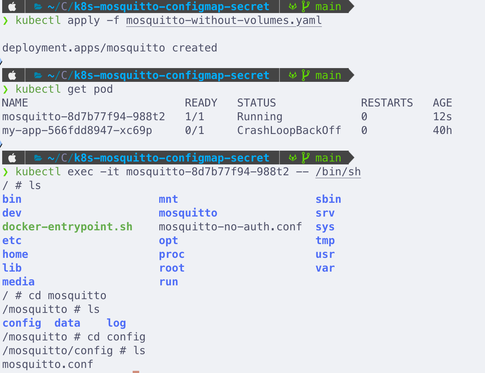
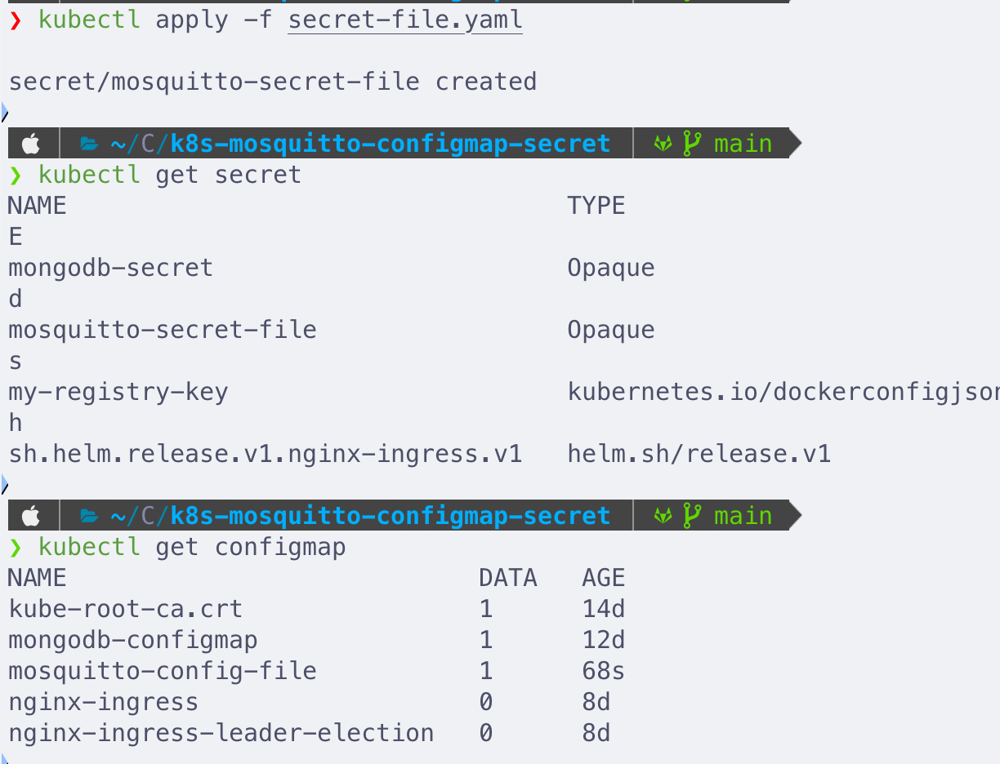
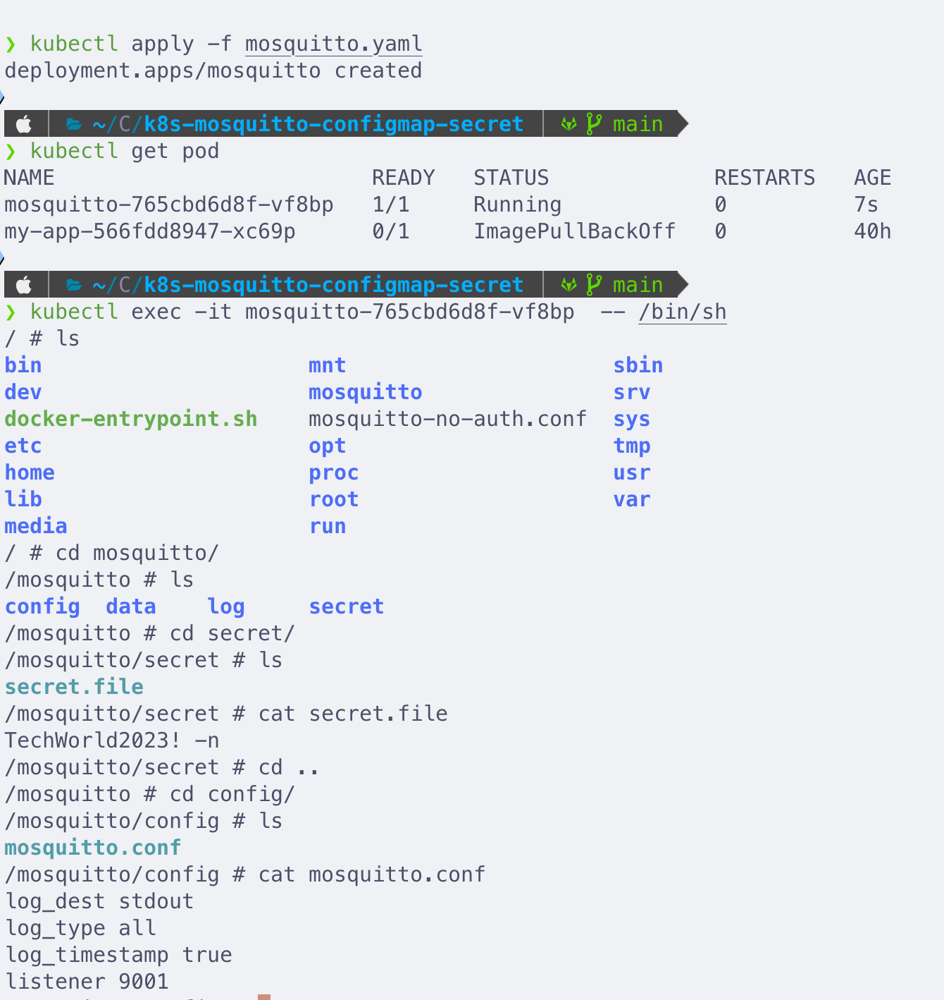

# k8s-mosquitto-configmap-secret

## Description

Deploy a Mosquitto message broker on Kubernetes and define its configuration and password using **ConfigMap** and **Secret** volume types.

ConfigMap and Secret are local volume types in Kubernetes. They let you create files (for example a config file or a password file) and mount them into a container, so you don't have to bake configuration into the image.

- The **ConfigMap** overrides Mosquitto's `mosquitto.conf`.
- The **Secret** provides a `secret.file` containing a password.

> **Important:** the ConfigMap and Secret must exist in the cluster **before** the Pod that uses them starts.

## Technologies Used

Kubernetes, Docker, Mosquitto

## Prerequisites

- A running Kubernetes cluster (e.g. Minikube) and `kubectl` configured to use it

## Steps

### 1. Deploy Mosquitto without volumes (see the defaults)

```bash
kubectl apply -f mosquitto-without-volumes.yaml
kubectl get pod
kubectl exec -it <pod-name> -- /bin/sh
```

Inside the container:

```bash
ls                # you will see a /mosquitto directory
cd mosquitto
ls                # config, data, log
cd config
ls                # mosquitto.conf (the default file)
exit
```



Delete the deployment:

```bash
kubectl delete -f mosquitto-without-volumes.yaml
```

### 2. Create the ConfigMap

`config-file.yaml` — the key under `data` (`mosquitto.conf`) becomes the file name, and its value becomes the file content:

```yaml
apiVersion: v1
kind: ConfigMap
metadata:
  name: mosquitto-config-file
data:
  mosquitto.conf: |
    log_dest stdout
    log_type all
    log_timestamp true
    listener 9001
```

```bash
kubectl apply -f config-file.yaml
```

### 3. Create the Secret

The value must be base64 encoded. Generate it with (`-n` avoids encoding a trailing newline):

```bash
echo -n 'TechWorld2023!' | base64
```

`secret-file.yaml`:

```yaml
apiVersion: v1
kind: Secret
metadata:
  name: mosquitto-secret-file
type: Opaque
data:
  secret.file: VGVjaFdvcmxkMjAyMyE=
```

```bash
kubectl apply -f secret-file.yaml
```

### 4. Verify both exist

```bash
kubectl get configmap
kubectl get secret
```



### 5. Create the Mosquitto Deployment that mounts both

Define the volumes at the Pod level with `volumes`, then mount them into the container with `volumeMounts`. `mountPath` is the path inside the container's filesystem.

`mosquitto.yaml`:

```yaml
apiVersion: apps/v1
kind: Deployment
metadata:
  name: mosquitto
  labels:
    app: mosquitto
spec:
  replicas: 1
  selector:
    matchLabels:
      app: mosquitto
  template:
    metadata:
      labels:
        app: mosquitto
    spec:
      containers:
        - name: mosquitto
          image: eclipse-mosquitto:2.0
          ports:
            - containerPort: 1883
          volumeMounts:
            - name: mosquitto-config
              mountPath: /mosquitto/config
            - name: mosquitto-secret
              mountPath: /mosquitto/secret
              readOnly: true
      volumes:
        - name: mosquitto-config
          configMap:
            name: mosquitto-config-file
        - name: mosquitto-secret
          secret:
            secretName: mosquitto-secret-file
```

```bash
kubectl apply -f mosquitto.yaml
kubectl get pod
```

### 6. Verify the mounted files

```bash
kubectl exec -it <pod-name> -- /bin/sh
```

Inside the container, check that both files are mounted:

```bash
cat /mosquitto/secret/secret.file      # shows the password
cat /mosquitto/config/mosquitto.conf   # shows the contents from the ConfigMap
```



### 7. Clean up

```bash
kubectl delete -f mosquitto.yaml
kubectl delete -f config-file.yaml
kubectl delete -f secret-file.yaml
```

## Summary

ConfigMap and Secret both store individual key-value pairs. When mounted as volumes, each key becomes a file in the container, which is how you pass configuration files and credentials to your Pods.